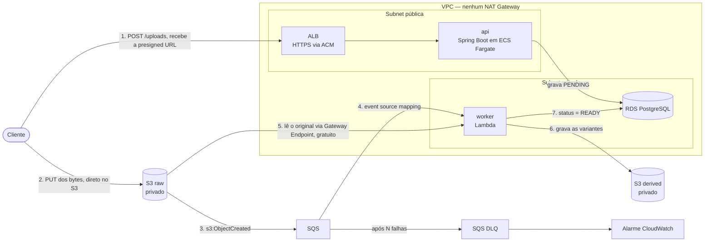
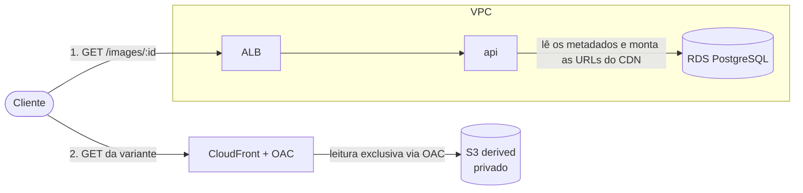

# Projeto — imagepipe

Pipeline de imagens orientado a eventos na **AWS**. O usuário sobe uma imagem, o sistema gera variantes
(miniaturas) de forma assíncrona e as serve por CDN. Backend puro — clientes são simulados (REST, Postman, testes).

> Este documento é o **brief** do projeto (o *quê* e o *porquê*). O plano de execução do MVP está em
> [`PROGRESS.md`](PROGRESS.md); a visão pós-MVP em [`FUTURE-PROGRESS.md`](FUTURE-PROGRESS.md).

## 1. Por que este projeto existe

O objetivo **não é o domínio**. Serviço de imagens é um pretexto deliberado.

O objetivo é **aprender o núcleo da AWS a fundo, na prática e na teoria**, com um projeto pequeno o bastante
para que o tempo seja gasto em infraestrutura e não em escrever Java. Escrever controller não ensina nuvem.

O domínio foi escolhido por uma razão precisa: **é o único em que todo serviço do núcleo da AWS aparece porque
o problema exige, não porque alguém quis colocá-lo ali.**

- O upload precisa de **presigned URL do S3**, senão o arquivo atravessa a aplicação e consome memória do container.
- O S3 emite evento, que precisa de **fila**, senão um pico de uploads perde trabalho.
- A fila precisa de consumidor, que é **Lambda**.
- A Lambda precisa de **role IAM com permissão mínima** — e se estiver errada, quebra.
- As variantes precisam ser servidas, o que pede **CloudFront**.
- Os metadados precisam de **RDS em subnet privada**, o que arrasta **VPC**, subnets e security groups.

Nada é decorativo. Um serviço aprendido por requisito inventado é um serviço aprendido mal.

### Contexto de portfólio

Este é o terceiro projeto de estudo do autor. Os outros dois já cobrem outros terrenos:

- **shopflow** — microsserviços, SAGA orquestrada, Kafka, observabilidade.
- **picpay-simplificado** — arquitetura hexagonal, testes de mutação, integrações resilientes.

Nenhum dos dois roda na nuvem. É essa a lacuna que o `imagepipe` fecha. Por isso ele é, deliberadamente, um
**monólito modular** — repetir microsserviços não acrescentaria nada, multiplicaria o custo de infraestrutura e
ensinaria exatamente a mesma AWS.

## 2. O que o sistema faz

### 2.1 Escrita: upload e processamento

Repare no passo 2: **os bytes nunca atravessam a `api`.** O cliente fala direto com o S3, usando uma URL que a
`api` assinou. E repare no que **não** existe no diagrama: nenhum NAT Gateway. O `worker` está numa subnet privada
e mesmo assim alcança o S3, porque passa por um VPC Gateway Endpoint, que é gratuito. Ele não precisa de endpoint
para o CloudWatch Logs (o serviço Lambda escreve por ele) nem para a SQS (o poller roda fora da VPC).

### 2.2 Leitura: consulta e entrega

O bucket `derived` é privado. Uma requisição direta à URL do S3 recebe **403**; só o CloudFront consegue lê-lo,
através do Origin Access Control.

## 3. Requisitos funcionais

1. **Solicitar upload** — `POST /uploads` valida tipo e tamanho, grava a imagem com status `PENDING` e devolve
   uma presigned URL do S3 com validade curta.
2. **Enviar o arquivo** — o cliente faz `PUT` direto no S3. A API nunca toca nos bytes.
3. **Processar** — o evento do S3 chega pela SQS; o worker gera as variantes e grava no bucket `derived`.
4. **Concluir ou falhar** — sucesso marca `READY`; imagem corrompida ou formato não suportado marca `FAILED`.
5. **Consultar** — `GET /images/{id}` retorna o status e, quando `READY`, as URLs do CloudFront.
6. **Servir** — as variantes são entregues pelo CloudFront; o bucket permanece privado.

## 4. Requisitos técnicos

- **Infraestrutura como código** com Terraform. Nenhum recurso criado pelo console, exceto o bootstrap do state.
- **Nenhum NAT Gateway.** A rede é desenhada para não precisar dele (ver seção 5).
- **Nenhuma senha de banco.** O acesso ao RDS usa autenticação IAM, com token assinado localmente.
- **Idempotência** no worker: a entrega da SQS é at-least-once e o evento do S3 pode chegar duas vezes.
- **DLQ** com alarme, e distinção explícita entre erro transitório e permanente.
- **Hexagonal horizontal** na `api` **e** no `worker`; domínio sem dependência de framework.
- **Testes** unitários e de integração (Testcontainers com PostgreSQL e LocalStack) com gates de cobertura.
- **CI/CD** no GitHub Actions autenticando por **OIDC**, sem chave de acesso de longa duração.

## 5. Decisões de arquitetura já tomadas

Estas cinco decisões antecedem a implementação e devem virar ADRs numerados em `docs/adr/`.

**Dois buckets, não um.** Se `raw` e `derived` fossem o mesmo bucket, a Lambda escreveria uma variante, o S3
emitiria um novo evento, a Lambda processaria a variante, e assim por diante. É a **invocação recursiva**, um dos
erros mais caros da AWS. Um filtro de prefixo evitaria, mas dois buckets tornam o erro *impossível* — e o
`derived` fica sendo o único que o CloudFront enxerga.

**Terraform, não CDK.** O CDK esconde o recurso AWS atrás de construtos de alto nível. Excelente em produção,
péssimo para aprender. O objetivo aqui é escrever o `aws_security_group` na mão.

**Rede sem NAT Gateway.** A `api` fica em subnet **pública**, com security group que só aceita tráfego do ALB.
A Lambda fica em subnet **privada** porque precisa do RDS — e ao entrar na VPC perde o acesso à internet.
Em vez de um NAT Gateway (cerca de US$ 33/mês), usa-se um **VPC Gateway Endpoint para S3, que é gratuito**.
A Lambda não precisa de endpoint para logs (o serviço Lambda escreve por ela) nem para a SQS (o poller roda
fora da VPC). O resultado é custo zero de rede e segurança melhor.

**Worker em Java puro, sem Spring — mas com hexágono próprio.** O `worker` expõe um
`RequestHandler<SQSEvent, SQSBatchResponse>` e usa AWS SDK v2 com JDBC. Spring num consumidor assíncrono só infla
cold start e tamanho do pacote, sem benefício algum. Ausência de framework, porém, não é desculpa para ausência de
arquitetura: o `worker` tem `domain`, `application` e `adapter` como qualquer outro módulo. O ganho é concreto —
`TransientProcessingException` e `PermanentProcessingException` são conceitos de **domínio**, e o adaptador Lambda
é quem os traduz em "devolve para a fila" ou "reconhece a mensagem". O objetivo de aprendizado número 4 fica
expresso na própria estrutura do código. O schema do banco é propriedade da `api`, que roda as migrações Flyway.

**Hexagonal horizontal, não vertical.** O topo de cada módulo é a **camada** (`domain`, `application`, `adapter`),
como no `partners-api` e no `shopflow` — não a feature, como no `picpay-simplificado`. O motivo é que o
`imagepipe` tem **um único agregado**, `Image`: os dois endpoints falam dele. Com uma feature só, o corte vertical
degenera numa fatia `image/` que reproduz, um nível abaixo, exatamente o layout horizontal. Seria aninhamento sem
ganho. O corte vertical volta a fazer sentido se surgirem features de fato independentes (moderação de conteúdo,
multi-tenancy) — o que hoje está em `FUTURE-PROGRESS.md` e portanto não deve guiar a estrutura de agora.

O módulo `shared` é um **kernel de domínio**, e tem uma regra rígida para não virar lixeira: **zero dependências
declaradas no seu `build.gradle.kts`**. Nada de Spring, AWS SDK ou JDBC. Cabem ali apenas `ImageStatus`,
`VariantSize` e `StorageKeys` — a derivação das chaves determinísticas, de que a `api` precisa para montar as URLs
do CloudFront e o `worker` para escrever as variantes.

## 6. Objetivos de aprendizado

Estes são os pontos que o projeto existe para ensinar. O checklist vive em [`PROGRESS.md`](PROGRESS.md).

1. Presigned URL com `Content-Type` e `Content-Length` assinados
2. Invocação recursiva do S3 e por que dois buckets a tornam impossível
3. Entrega at-least-once e idempotência por chave determinística
4. Erro transitório versus permanente, e por que a DLQ morre sem essa distinção
5. `ReportBatchItemFailures` e a falha do lote inteiro
6. Visibility timeout de pelo menos seis vezes o timeout da função
7. Backoff exponencial não é nativo da SQS
8. Gateway Endpoint gratuito versus Interface Endpoint pago versus NAT Gateway
9. Lambda dentro da VPC perde o acesso à internet
10. Autenticação IAM do RDS: token assinado localmente, senha nenhuma
11. Task role versus execution role no ECS
12. Security group referenciando security group, não CIDR
13. CloudFront com OAC mantendo o bucket privado
14. GitHub Actions com OIDC, sem chave de longa duração no repositório
15. SSRF e IMDSv2 (quando houver importação por URL)
16. ECS Exec no lugar de bastion com chave SSH
17. Ciclo de vida do S3 abortando multipart incompleto
18. `terraform destroy` como instrumento de controle de custo

## 7. Critérios de aceitação

- [ ] `POST /uploads` devolve presigned URL com validade menor ou igual a 5 minutos.
- [ ] `PUT` com `Content-Type` divergente do assinado é **recusado pelo S3**.
- [ ] Após o `PUT`, o status vira `READY` e as variantes existem no bucket `derived`.
- [ ] Reprocessar o mesmo evento do S3 **não** duplica linha nem altera o resultado.
- [ ] Imagem corrompida marca `FAILED`, a mensagem é reconhecida e a **DLQ permanece vazia**.
- [ ] Lote de 10 mensagens com 1 ruim devolve exatamente **um** `itemIdentifier`.
- [ ] Qualquer mensagem na DLQ dispara alarme no CloudWatch.
- [ ] URL direta do S3 retorna **403**; URL do CloudFront retorna **200** com o content-type correto.
- [ ] O state do Terraform **não contém nenhum `aws_nat_gateway`**.
- [ ] Não existe senha de RDS em lugar nenhum (nem no state, nem em variável de ambiente).
- [ ] Os secrets do repositório **não contêm `AWS_ACCESS_KEY_ID`**.
- [ ] `terraform destroy` deixa **zero recurso faturável**.
- [ ] `./gradlew check integrationTest pitest` verde (unit + gates JaCoCo, integração Testcontainers, mutação).
- [ ] Pipeline do GitHub Actions verde, incluindo o smoke test pós-deploy contra a AWS real.

## 8. Restrição de custo

A conta é nova (modelo pós-15/07/2025), no **Free plan**: até **US$ 200 em créditos**, expirando em **6 meses**
ou quando os créditos acabarem, o que vier primeiro. No Free plan a AWS **não cobra** — a conta encerra.

Com tudo ligado 24 horas, o ambiente custa cerca de **US$ 40/mês**. Não é assim que ele deve ser operado.
O ambiente é **descartável**: sobe com `terraform apply` para estudar uma peça, desce com `terraform destroy`
em seguida. O desenvolvimento do dia a dia acontece local, com Docker Compose e LocalStack.

**Meta: menos de US$ 60 no trimestre inteiro.** O relatório real do Cost Explorer entra no README ao final.

## 9. Fora de escopo

Não fazem parte do MVP e vivem em [`FUTURE-PROGRESS.md`](FUTURE-PROGRESS.md): Cognito, DynamoDB, Aurora
Serverless, API em Lambda com SnapStart, Step Functions, WAF, KMS com chave própria, blue/green, multi-região,
moderação de conteúdo e formatos avançados de imagem.
